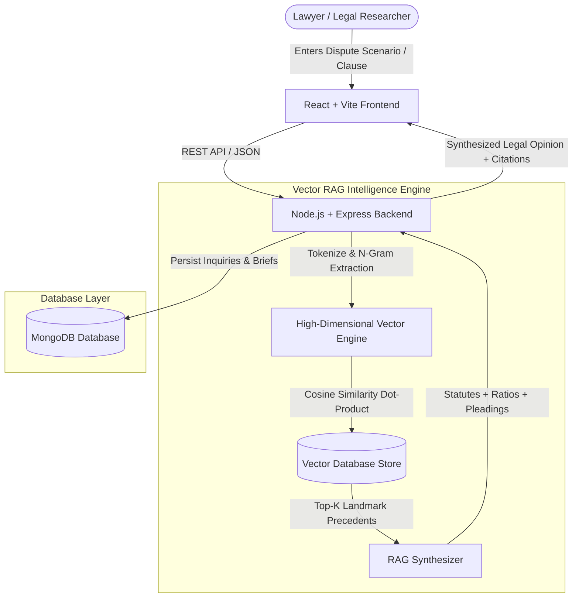

# ⚖️ LexiCore AI: AI-Based Legal Research Assistant for Commercial Disputes
### Retrieval-Augmented Generation (RAG) & Vector Database Architecture (MERN Stack)

> **LexiCore AI** is a state-of-the-art Legal-Tech platform designed for commercial litigators, corporate legal teams, and law firms. It accelerates research in complex commercial disputes (*Breach of Contract, International Arbitration, Liquidated Damages, Insolvency & IBC, Bank Guarantee Injunctions, and IP Trade Secrets*) by utilizing high-dimensional **Vector Search** and a **Retrieval-Augmented Generation (RAG)** pipeline.

---

## 🏛️ System Architecture



---

## 🌟 Key Modules & Features

### 1. 🤖 AI Legal Research Assistant (RAG Pipeline)
- **Natural Language Fact Pattern Ingestion**: Enter real-world commercial disputes in plain English.
- **Sub-Second Vector Search**: Retrieves top-matching High Court & Supreme Court precedents using Cosine Similarity metrics.
- **RAG Context Synthesis**:
  - Synthesized Commercial Legal Opinion
  - Cited Precedents with exact citation, court, and similarity percentage
  - Relevant statutory provisions (*e.g., Section 56 Frustration, Section 73/74 Damages, Arbitration Act Sec 34, IBC Sec 9*)
  - **Petitioner / Claimant Pleadings vs. Respondent Defense Rebuttals**
  - Settlement & Litigation Exposure Rating (*Low, Moderate, High, Critical*)
  - Strategic Senior Counsel Action Items

### 2. 📚 Commercial Precedents Vector Library
- Filterable and searchable repository of landmark judgments across 7 commercial domains.
- Real-time semantic vector query mode vs. keyword search.
- Interactive modal showing full factual matrices, ratios decidendi, and legal issues.

### 3. 🛡️ Contract Clause Risk & Vulnerability Analyzer
- Audit high-risk commercial clauses (*Force Majeure, Uncapped Indemnity, Post-Term Non-Compete, Termination for Convenience*).
- **Risk Score Gauge (0 - 100)** with clear categorization (*Low, Moderate, High, Severe Vulnerability*).
- Side-by-side comparison with an **AI-recommended renegotiation clause draft** and 1-click copy.

### 4. 📝 Commercial Case Brief & Argument Drafter
- Automated generation of court-ready commercial litigation briefs.
- Includes Statement of Facts, Questions of Law, Governing Law, Claimant Pleadings, Defense Rebuttals, and Strategic Counsel Opinion.
- Built-in **Print / PDF Export** functionality.

### 5. ➕ Vector Data Ingestion Portal
- Ingest new court judgments and commercial awards into the vector store with automated tokenization and embedding generation.

---

## 🛠️ Tech Stack

- **Frontend**:
  - React 18 + Vite
  - Tailwind CSS (Premium Dark Legal-Tech Aesthetic)
  - Lucide React Icons
  - React Router DOM v6
  - Axios
- **Backend**:
  - Node.js & Express.js
  - MongoDB & Mongoose
  - In-house High-Performance Vector Similarity Engine (TF-IDF + Legal N-Grams + Cosine Similarity)
  - Seamless dual-mode: Works with local MongoDB or automatic high-speed in-memory store fallback.

---

## 🚀 How to Run the Project

### Prerequisites
- Node.js (v18+)
- (Optional) MongoDB running on default port `27017`

### Step 1: Clone / Open Directory
```bash
cd c:\Users\RAHUL\Downloads\fsdpro
```

### Step 2: Start Backend
In terminal 1:
```powershell
cd backend
npm.cmd start
```
*Backend runs on:* `http://localhost:5000`  
*Health Check:* `http://localhost:5000/api/health`

### Step 3: Start Frontend
In terminal 2:
```powershell
cd frontend
npm.cmd run dev
```
*Frontend runs on:* `http://localhost:5173`

*(Alternatively on Windows: Double click `start-project.bat` to launch both servers automatically!)*

---

## 📡 REST API Reference

| Method | Endpoint | Description |
| :--- | :--- | :--- |````
| `GET` | `/api/health` | System and Vector Database health check |
| `GET` | `/api/precedents` | Retrieve all indexed commercial precedents |
| `POST` | `/api/precedents/vector-search` | Query precedents using Cosine Vector Similarity |
| `POST` | `/api/precedents` | Ingest and vectorize a new judgment |
| `GET` | `/api/precedents/stats` | Summary statistics and vector dimensions |
| `POST` | `/api/research/query` | **Execute RAG pipeline query on a dispute scenario** |
| `GET` | `/api/research/history` | Retrieve past legal inquiries |
| `POST` | `/api/clauses/analyze` | Evaluate contract clause risk score & vulnerabilities |
| `POST` | `/api/briefs/generate` | Generate formal Petitioner/Respondent Case Brief |

---

## 👨‍⚖️ Sample Pre-Seeded Commercial Cases
1. *Energy Infra Corp v. Global Gas Transporters Ltd* — (2022) 4 SCC 342 (Take-or-pay gas contract & Section 56 Force Majeure)
2. *Kailash Metro Buildcon v. NHDA* — (2020) 8 SCC 189 (Liquidated damages proof of loss under Section 74)
3. *Apex Telecom Consortium v. Zenith Satellites BV* — 2023 SCC OnLine SC 892 (Arbitral award setting aside under Section 34 for consequential loss)
4. *Matrix Cybernetics v. Nexus Enterprise Cloud* — 2021 (86) PTC 412 (Trade secret confidentiality vs Section 27 Non-compete)
5. *Starlight Heavy Engineering v. State Bank & Larsen Metals* — (2019) 15 SCC 210 (Injunction on unconditional Bank Guarantee)
6. *Quantum Logistics Solutions v. Prime Retail India* — 2023 SCC OnLine NCLAT 441 (IBC Section 9 operational debt pre-existing dispute)
7. *Vanguard Capital Partners v. Orion Ventures Global* — (2021) 9 SCC 625 (Enforceability of SHA Put Option exit clauses)

